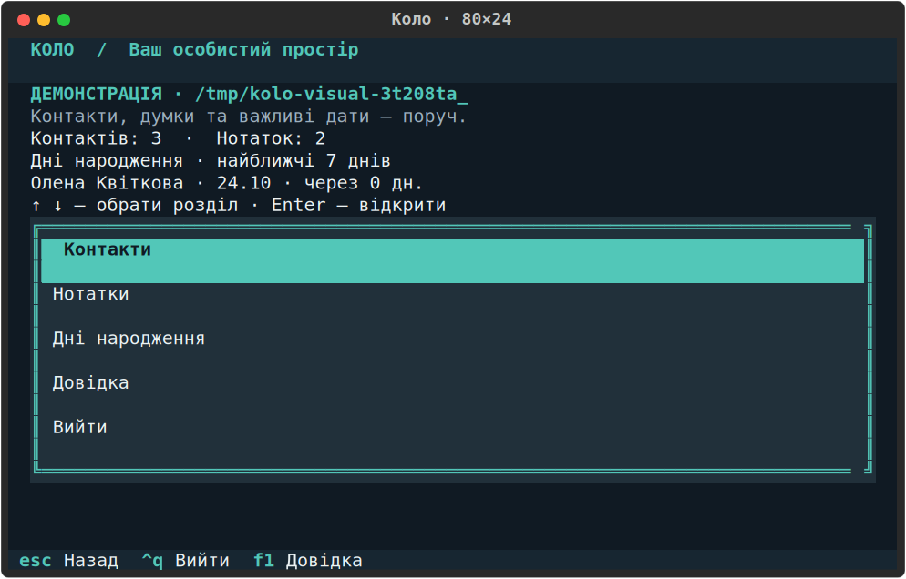

# Коло

Ваші люди, думки та важливі дати — поруч. «Коло» — український персональний помічник у терміналі: контакти, нотатки з тегами та найближчі дні народження. Дані зберігаються на вашому комп’ютері; під час користування інтернет не потрібен.



*Справжній екран демонстраційного режиму, 80×24. Усі записи вигадані; дати й тимчасовий шлях у вашому сеансі відрізнятимуться.*

## Швидкий старт після клонування

Потрібні Python 3.12 та [uv](https://docs.astral.sh/uv/). У Linux або Ubuntu WSL:

```sh
git clone https://github.com/iktnb/kolo-assistant.git
cd kolo-assistant
uv sync --locked --all-groups
uv run --no-sync kolo demo
```

Демонстрація працює з тимчасовими вигаданими записами. Для власних даних запустіть `uv run --no-sync kolo`. Перший запуск підготовки може потребувати інтернету; застосунок надалі працює локально.

[Відповідність усім вимогам завдання та докази перевірок](docs/requirements-coverage.md).

## Відкрити застосунок

Версія проєкту **1.1.0** відкриває повноекранний інтерфейс із керуванням клавіатурою. Щоб запустити поточні джерела в підготовленому середовищі цього проєкту, відкрийте Windows Terminal або PowerShell:

```powershell
wsl.exe -d Ubuntu -- /home/iknow/goit-projects/personal-assistant/run.sh demo
```

Почніть із демонстрації, вийдіть через «Вийти» або Ctrl+Q із підтвердженням, потім відкрийте власні записи:

```powershell
wsl.exe -d Ubuntu -- /home/iknow/goit-projects/personal-assistant/run.sh
```

Для локально встановленої копії є окремий вхід, незалежний від поточного каталогу:

```powershell
wsl.exe -d Ubuntu -- /home/iknow/.local/bin/kolo demo
wsl.exe -d Ubuntu -- /home/iknow/.local/bin/kolo
wsl.exe -d Ubuntu -- /home/iknow/.local/bin/kolo --help
```

Безпосередньо в терміналі Ubuntu:

```sh
kolo demo
kolo
kolo --help
kolo --version
```

`kolo` використовує встановлену копію; її версію показує `--version`. Після зміни джерел запускайте `run.sh` або `uv run --no-sync kolo` з кореня проєкту. Інструкція підготовки середовища — нижче.

Повноекранний і рядковий режими та `demo` потребують справжнього термінала. Команди контактів, нотаток і днів народження працюють також у сценаріях та з перенаправленими потоками.

Демонстрація показує позначку «Демонстрація» та шлях окремого тимчасового сховища. Вона містить лише вигадані контакти й нотатки, не читає особисте сховище, а зміни прибираються після звичайного виходу. Наступний запуск починається заново. Поєднання `demo` з явним `--data-dir` відхиляється.

## Керування клавіатурою

| Клавіша | Дія |
| --- | --- |
| ↑ / ↓ | Вибрати пункт меню або запис у списку. |
| Enter | Відкрити вибраний пункт чи деталі; натиснути кнопку у фокусі. |
| Tab / Shift+Tab | Перейти до наступного / попереднього поля чи кнопки. |
| Esc або «Назад» | Повернутися; спочатку закрити відкритий список вибору чи підтвердження. |
| Ctrl+S або «Зберегти» | Зберегти відкриту форму. |
| F2 | Додати запис у списку контактів або нотаток. |
| F1 | Відкрити довідку поза формою. |
| Ctrl+Q / Ctrl+C | Запросити вихід із підтвердженням. |

У текстових полях стрілки рухають курсор. У багаторядкових полях Enter додає новий рядок, Tab переходить далі; Enter у полі не зберігає форму. Поточний фокус видно за рамкою або виділенням; за браку місця вміст прокручується.

1. На головному екрані виберіть «Контакти» стрілками й натисніть Enter. Через «Додати» або F2 створіть контакт: достатньо імені, необов’язкові поля можна залишити порожніми.
2. Виберіть запис у списку й натисніть Enter. У деталях доступні всі поля, «Редагувати», «Видалити» та «Назад»; вводити ID не потрібно. Додаткові дані й ID допомагають розрізняти однакові імена або заголовки.
3. У «Нотатках» додайте заголовок і текст. Телефони контакту й теги нотатки вводяться **по одному на рядок**. Під час редагування очистіть необов’язкове поле повністю, щоб прибрати його значення; порожнє поле тегів прибирає всі теги.
4. Для пошуку введіть запит і натисніть Enter або «Застосувати». Нотатки можна додатково відфільтрувати за точним тегом і відсортувати за заголовком або тегами. «Очистити фільтри» повертає повний список. У «Днях народження» задайте інтервал 0–366 днів і застосуйте його; вибраний рядок відкриває контакт.

«Назад» зберігає пошук, фільтри, порядок, вибраний запис і позицію списку. Після збереження вибирається збережений запис; якщо він не відповідає фільтру, програма пояснює це й залишає фільтр. Після видалення вибирається сусідній запис.

Помилка поля залишає всю чернетку й переводить фокус до поля для виправлення. За невдалого запису чернетка лишається: повторіть збереження після усунення причини. Помилка читання показує шлях сховища та дії «Повторити», «Назад», «Вийти»; базу не скидають.

Вихід із зміненої форми через Esc/«Назад» або Ctrl+Q/Ctrl+C потребує підтвердження втрати чернетки; початковий вибір — «Продовжити редагування». Видалення показує назву та ID й початково вибирає «Залишити»: перейдіть до «Видалити», щоб підтвердити. Вихід із застосунку також підтверджується; Esc на головному екрані відкриває цей запит.

## Поля та правила

- **Ім’я контакту й заголовок нотатки:** 1–120 символів після обрізання крайніх пробілів. Однакові імена й заголовки дозволено: кожен запис має свій незмінний ID.
- **Телефони:** 10–15 цифр `0–9`, необов’язковий `+` на початку. Пробіли, дужки й дефіси прибираються: `+38 (067) 123-45-67` → `+380671234567`. У повноекранній формі — один номер на рядок. Повтор номера в одному контакті відхиляється; спільний номер у різних контактах дозволено.
- **Адреса й email:** необов’язкові; адреса до 500 символів, email до 254 ASCII-символів у звичайному форматі `name@example.com`. Існування поштової скриньки не перевіряється.
- **Дата народження:** справжня дата `YYYY-MM-DD`, не пізніше сьогодні. Типовий часовий пояс — `Europe/Kyiv`; непорожній `KOLO_TIMEZONE` задає іншу IANA-зону, наприклад `UTC`, без зміни налаштувань ОС.
- **Текст нотатки:** 1–10000 символів, не лише пробіли. Enter додає рядок у редакторі; початкові та кінцеві порожні рядки зберігаються.
- **Теги:** необов’язкові, до 40 символів кожен, один тег на рядок. `Робота` та ` робота ` стають одним тегом `робота`; кома є частиною тегу.

Довгі значення переносяться; усі поля й повний текст доступні в деталях. Кольори доповнено текстовими підписами та видимим фокусом. `--plain` і змінна `NO_COLOR` прибирають кольори, **зберігаючи повноекранне керування** та службові послідовності термінала. У командному виводі перенаправлення також вимикає кольори. Керувальні символи в даних відображаються без виконання.

## Рядковий режим із числовим меню

Попереднє меню доступне явно: глобальна опція `--line-mode` стоїть **перед** командою.

```sh
kolo --line-mode
kolo --line-mode demo
```

Тут `1` — контакти, `2` — нотатки, `3` — дні народження, `4` — довідка, `0` — вихід; для дій із записом потрібен повний ID зі списку. Телефони розділяються `;`, текст нотатки завершується окремим рядком `.`; додаткова початкова крапка екранує його (`..` зберігає `.`). Теги вводяться по одному до порожнього рядка.

Під час редагування Enter залишає поточне поле, `!clear` очищує необов’язкове; `!!` на початку зберігає буквальний `!` (`!!clear` → `!clear`). Для тегів перший Enter залишає набір, `!clear` очищує його. Текст змінюється після ствердної відповіді на «Змінити текст?». Видалення потребує `т`, `так`, `y` або `yes`; решта відповідей залишає запис. Ctrl+C скасовує дію до панелі, Ctrl+D завершує сеанс без незбережених змін.

## Команди для контактів і нотаток

Нижче — приклади для термінала Ubuntu. Глобальні `--data-dir`, `--plain` і `--line-mode` стоять **перед** командою. Довідка є на кожному рівні: `kolo notes edit --help`.

Для проби створіть окремий навчальний каталог. Залишайте цей термінал відкритим: змінна `KOLO_DATA` потрібна наступним командам.

```sh
KOLO_DATA=$(mktemp -d /tmp/kolo-practice.XXXXXX)
kolo --data-dir "$KOLO_DATA" contacts add --name "Олена" --phone "+38 (067) 123-45-67" --phone "0501234567" --address "Київ" --email "olena@example.com" --birthday 1995-03-21
kolo --data-dir "$KOLO_DATA" contacts list --search "олена"
```

Створення й список показують повний ID. У наступному блоці **замініть приклад `c_0123456789ab` на ID свого щойно створеного контакту**:

```sh
CONTACT_ID=c_0123456789ab
kolo --data-dir "$KOLO_DATA" contacts show "$CONTACT_ID"
kolo --data-dir "$KOLO_DATA" contacts edit "$CONTACT_ID" --address "Львів" --clear-email
kolo --data-dir "$KOLO_DATA" contacts delete "$CONTACT_ID" --yes
```

Так само працюють нотатки, текстовий пошук і теги:

```sh
kolo --data-dir "$KOLO_DATA" notes add --title "Ідеї" --body "Перша думка" --tag Робота --tag "дім,сад"
kolo --data-dir "$KOLO_DATA" notes list --search "думка" --tag робота --sort tags
```

**Замініть `n_0123456789ab` на ID нотатки зі списку**:

```sh
NOTE_ID=n_0123456789ab
kolo --data-dir "$KOLO_DATA" notes show "$NOTE_ID"
kolo --data-dir "$KOLO_DATA" notes edit "$NOTE_ID" --title "Нові ідеї" --body "Оновлена думка" --tag навчання
kolo --data-dir "$KOLO_DATA" notes edit "$NOTE_ID" --clear-tags
kolo --data-dir "$KOLO_DATA" notes delete "$NOTE_ID" --yes
```

Команди приймають тільки повний ID; однакове ім’я або короткий префікс його не замінюють. У редагуванні потрібне хоча б одне поле: пропущені поля не змінюються, `--phone` замінює весь список телефонів, `--tag` — весь набір тегів. Для очищення є `--clear-phones`, `--clear-address`, `--clear-email`, `--clear-birthday`, `--clear-tags`; порожні `--address ""`, `--email ""`, `--birthday ""` теж очищують поле. Значення та його `--clear-…` одночасно не приймаються.

Багаторядковий текст можна передати з UTF-8 файлу або явно зі стандартного вводу:

```sh
printf 'Перший рядок\nДругий рядок\n' > "$KOLO_DATA/plan.txt"
kolo --data-dir "$KOLO_DATA" notes add --title "План" --body-file "$KOLO_DATA/plan.txt" --tag робота
printf 'Перший рядок\nДругий рядок\n' | kolo --data-dir "$KOLO_DATA" notes add --title "План зі stdin" --body-file -
```

Пошук контактів перевіряє ім’я, адресу, email та цифри телефону. Пошук нотаток перевіряє заголовок і текст без урахування регістру; заданий тег має збігатися точно після нормалізації, і обидві умови застосовуються разом. Порожній пошук показує всі записи. Типове сортування нотаток — `title`; `tags` сортує за набором тегів, далі заголовком та ID, а нотатки без тегів ставить останніми.

```sh
kolo --data-dir "$KOLO_DATA" birthdays --days 7
kolo --data-dir "$KOLO_DATA" birthdays --days 0
```

`--days N` приймає ціле число 0–366 та включає сьогодні й останній день проміжку. Кожен контакт показується один раз із найближчою річницею. Для народжених 29 лютого у звичайному році береться 28 лютого, у високосному — 29; збережена дата народження не змінюється.

Навчальні записи лишаються лише в каталозі `$KOLO_DATA`. Для власних даних запускайте `kolo` або команди без `--data-dir`.

Успішні результати йдуть у stdout, помилки — у stderr. Коди завершення: `0` — успіх, `2` — помилка вводу / відсутній ID / видалення без `--yes`, `1` — помилка сховища, `130` — переривання командної дії. Команди не ставлять прихованих запитань. Неправильне редагування не змінює запис частково.

## Дані та резервна копія

Записи зберігаються між запусками в одному файлі `kolo.sqlite3`. Каталог обирається так:

1. Явний `--data-dir ШЛЯХ`; відносний шлях відраховується від поточного каталогу на старті.
2. Непорожній абсолютний `XDG_DATA_HOME` + `/kolo`; відносний XDG ігнорується.
3. `~/.local/share/kolo` — у цьому середовищі `/home/iknow/.local/share/kolo`.

Окремий `--data-dir` ізольований від стандартного сховища. Нові каталоги мають права `0700`, файл — `0600`; дані не шифруються й не передаються в мережу. Успішна зміна зберігається до повідомлення «Збережено». За помилки доступу, пошкодження чи невідомої версії програма пояснює проблему й показує шлях, без скидання бази. Автоматичного ремонту пошкоджених файлів немає. Для зберігання використовуйте файлову систему Linux/WSL із підтримкою hard links і fsync.

Для резервної копії закрийте всі сеанси «Коло» та скопіюйте **весь каталог даних**. Для стандартного шляху, якщо `XDG_DATA_HOME` не задано:

```sh
cp -a "$HOME/.local/share/kolo" "$HOME/.local/share/kolo-backup-$(date +%Y%m%d-%H%M%S)"
```

Якщо задано `--data-dir` або `XDG_DATA_HOME`, копіюйте саме відповідний каталог. Копія містить особисті дані у відкритому вигляді — зберігайте її у приватному місці.

Імпорт/експорт, синхронізація, фонові нагадування, автоматичні міграції формату та одночасне спільне редагування не підтримуються. Фізичне стирання даних і несправність носія поза гарантіями застосунку.

## Запуск із вихідного коду

Потрібні Python 3.12 і [uv](https://docs.astral.sh/uv/). Із термінала Ubuntu:

```sh
cd /home/iknow/goit-projects/personal-assistant
/home/iknow/.local/bin/uv sync --locked --all-groups
/home/iknow/.local/bin/uv run --no-sync kolo --help
./run.sh
```

Перший `uv sync` може потребувати інтернету. `run.sh` запускає підготовлене середовище без синхронізації й працює з іншого каталогу:

```sh
/home/iknow/goit-projects/personal-assistant/run.sh demo
/home/iknow/goit-projects/personal-assistant/run.sh contacts list
```

`kolo` запускає встановлену локальну копію; після зміни джерел користуйтеся `./run.sh`, `uv run --no-sync kolo` або `uv run --no-sync python -m kolo`. Файл `start-kolo.cmd` у корені проєкту передає запуск та аргументи до `run.sh` в Ubuntu WSL.

## Перевірки розробки

Із кореня репозиторію:

```sh
/home/iknow/.local/bin/uv sync --locked --all-groups
/home/iknow/.local/bin/uv run --no-sync ruff format --check .
/home/iknow/.local/bin/uv run --no-sync ruff check .
/home/iknow/.local/bin/uv run --no-sync mypy .
/home/iknow/.local/bin/uv run --no-sync pytest --cov=src/kolo --cov-report=term-missing --cov-fail-under=80
/home/iknow/.local/bin/uv run --no-sync bandit -r src/kolo
/home/iknow/.local/bin/uv export --frozen --all-groups --no-emit-project --format requirements-txt --output-file /tmp/kolo-audit-requirements.txt
/home/iknow/.local/bin/uv run --no-sync pip-audit --requirement /tmp/kolo-audit-requirements.txt --no-deps --disable-pip --require-hashes
/home/iknow/.local/bin/uv build
```

Поточний повний прогін розробника: **227 тестів, покриття 95.54% усього `src/kolo`**, усі обов’язкові перевірки пройдено. Незалежний QA окремо виконав **30 приймальних перевірок із поточного набору** й перевірив відповідність результатів повного прогону тій самій версії джерел. Тести використовують тимчасові дані, окремі процеси й справжні термінальні сеанси. Деталі: [QA-звіт](docs/sdd/keyboard-tui/06-qa-report.md), [незалежний огляд коду](docs/sdd/keyboard-tui/05-code-review.md), [зміни документації](docs/sdd/keyboard-tui/07-doc-diff.md). [Попередні матеріали версії 1.0.0](docs/sdd/personal-assistant/06-qa-report.md) збережено окремо.

Реалізацію 1.1.0 перевірено локально; документація описує поточні джерела. Фінальна перевірка пакета та встановленої копії належить до локальної передачі. Зовнішній реліз і публікація не виконувалися.
