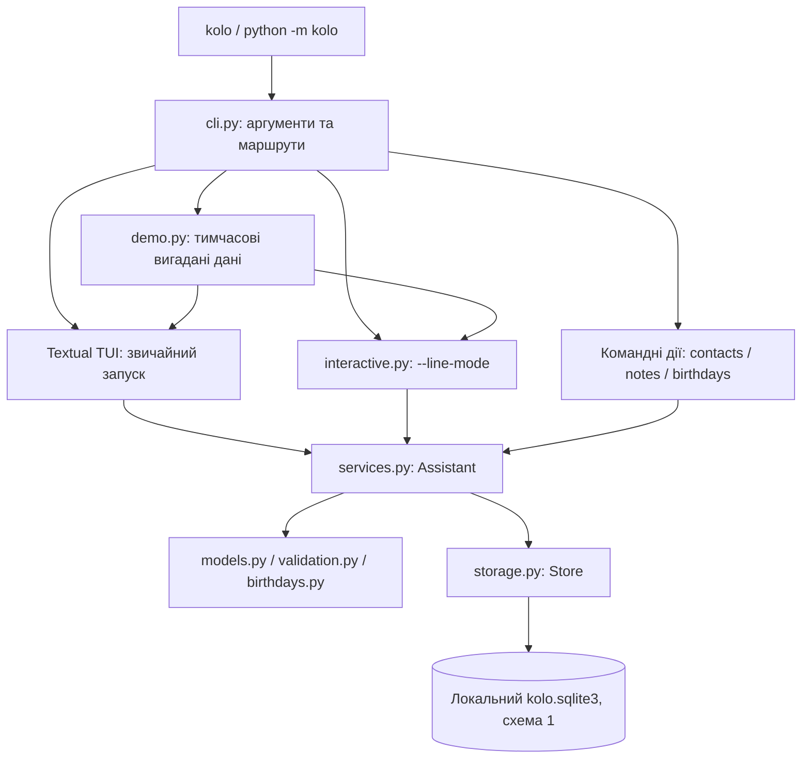

# Архітектура Коло

[Документація](README.md) · [Розробка й перевірки](developer-guide.md) · [Матриця вимог](requirements-coverage.md)

## Один локальний застосунок

«Коло» — самостійний термінальний застосунок Python 3.12. Інтерфейс, доменна логіка й SQLite розміщені в одному репозиторії та виконуються одним процесом. Це не набір окремих вебфронтенду й бекенду. HTTP API, ML, брокерів подій, зовнішнього сервера та браузерного розгортання немає.

Runtime використовує Textual 8.2.8 для повноекранних віджетів, Rich для виводу й стандартний `sqlite3`. Після підготовки залежностей застосунок не потребує мережі. Локальні дані не надсилаються на GitHub.

## Шари та режими запуску

[cli.py](../src/kolo/cli.py) обирає маршрут. Звичайний запуск і `demo` потребують TTY; відсутність термінала відхиляється до відкриття даних. Командні дії працюють без прихованих запитань. Глобальні опції стоять перед командою; `--plain` змінює кольори, `--line-mode` явно обирає попередню оболонку.

[Assistant](../src/kolo/services.py) — спільний шлях для CRUD, пошуку та календаря в усіх оболонках. Він використовує незмінні моделі й patch-об’єкти з [models.py](../src/kolo/models.py), [валідацію](../src/kolo/validation.py) та [календар](../src/kolo/birthdays.py). `UNSET` у patch означає «не змінювати», а порожнє необов’язкове значення — очистити.

## Практичне спадкування й поліморфізм

Власний базовий клас [`KoloScreen`](../src/kolo/tui.py) успадковує `Screen[None]` бібліотеки Textual. Від нього успадковані `HomeScreen`, `RecordsScreen`, `DetailScreen`, `HelpScreen` та `FormScreen`. Спільний клас містить заголовок, статус повідомлень, footer і обробку Esc, тому ці можливості не дублюються в кожному екрані.

Спадкоємці перевизначають `leave()` відповідно до своєї поведінки:

| Клас | Реальна дія при поверненні |
| --- | --- |
| `KoloScreen` | Прибрати поточний екран через `pop_screen()` |
| [`FormScreen(KoloScreen)`](../src/kolo/tui_forms.py) | Якщо форму змінено — запросити підтвердження втрати чернетки; інакше повернутися |
| [`HomeScreen(KoloScreen)`](../src/kolo/tui_screens.py) | Запросити підтвердження виходу із застосунку |

`KoloApp.request_back()` викликає `self.screen.leave()`. Python обирає перевизначений метод фактичного класу екрана: це практичний поліморфізм. `FormScreen` також викликає `super().__init__()` і розширює `KoloScreen.BINDINGS` клавішею Ctrl+S.

Щоб побачити це: `kolo demo` → «Контакти» → F2 → введіть ім'я → Esc. Замість втрати тексту відкриється підтвердження з початковим вибором продовжити редагування. Після повернення на головний екран Esc запропонує вийти. Сценарій захищає `test_dirty_safe_defaults_and_discard` у [тестах TUI](../tests/test_tui.py).

Є й інші приклади: [`FieldError(InputError)`](../src/kolo/errors.py) додає назву помилкового поля; форма використовує її для повернення фокуса, а загальна обробка `InputError` охоплює цю спеціалізовану помилку. Власні [`Parser` та `UkrainianFormatter`](../src/kolo/cli.py) перевизначають поведінку `argparse` для контрольованих помилок і української довідки. Моделі `Contact` та `Note` є окремими dataclass; наведена ієрархія працює в інтерфейсі, парсері та помилках.

## Повноекранна оболонка

| Модуль | Задача |
| --- | --- |
| [tui.py](../src/kolo/tui.py) | `KoloApp`, спільний екран, тема, безпечний вихід, послідовне виконання I/O |
| [tui_screens.py](../src/kolo/tui_screens.py) | Головний екран, списки, деталі, календар, довідка, контекст повернення |
| [tui_forms.py](../src/kolo/tui_forms.py) | Форми, підтвердження, помилка читання, збереження чернетки, точне відновлення тексту |
| [tui.tcss](../src/kolo/tui.tcss) | Компонування, прокручування, фокус, виділення, стани помилок |

Екрани використовують native Input, TextArea, ListView, Select і Button. Стрілки/Enter діють у сфокусованому віджеті; звичайні символи вводу не є глобальними діями. Список пов’язує рядок зі стійким ID, а не з номером позиції. Повернення зберігає запит, тег, сортування, вибраний запис і прокручування.

Сховище викликається через `AssistantIO` послідовно в `asyncio.to_thread`, тому очікування диска не блокує обробку клавіш. SQL-з’єднання відкривається для операції всередині робочого потоку. Результат повертається в цикл інтерфейсу; застаріле чи вже прикрите читання не повинно змінювати чужий екран.

Під час запису повторна дія не запускає другий commit. Запит повернення чи виходу чекає завершення запису, потім проходить безпечне підтвердження. За помилки поля чи сховища введені значення зберігаються для виправлення й явного повторення.

## Як проходить збереження

1. Форма копіює введені значення й позначає операцію зайнятою.
2. `Assistant` перевіряє й нормалізує кандидата; пропущені patch-поля залишають старі значення.
3. `Store` виконує зміну в транзакції; помилка призводить до rollback.
4. Лише після успішного commit повертається результат і показується «Збережено».
5. Початковий список перечитується; вибирається збережений ID або пояснюється, що він не відповідає чинному фільтру.

Для тексту нотатки редактор використовує LF-представлення, але окремо зберігає відповідність початковим розділювачам рядків. Якщо текст не змінено, початкові raw spans повертаються одразу; якщо початкові переноси вже LF, реконструкція дорівнює поточному канонічному тексту й не потребує diff. Для зміненого історичного тексту зі змішаними розділювачами лишається `SequenceMatcher(autojunk=False)` з попереднім правилом неоднозначного зіставлення; його гірший випадок усе ще квадратичний. Незмінені частини повертають початкові LF/CRLF/CR та Unicode-розділювачі; новий Enter додає LF. Ліміт 10000 перевіряється для збереженого тексту. Відображення керувальних символів і Rich-розмітки не повинно виконувати їх або підміняти сирі дані моделі.

## Моделі й SQLite

| Сутність | Основні дані | Зв’язки |
| --- | --- | --- |
| Контакт | ID, ім’я, адреса, email, дата народження | Кілька телефонів у `contact_phones` |
| Нотатка | ID, заголовок, точний текст | Набір тегів у `note_tags` |

ID мають вигляд `c_…` і `n_…`, генеруються під час створення й не змінюються. Однакові імена/заголовки дозволені. Телефони нормалізуються й не повторюються в одному контакті; теги нормалізуються та усувають повтори. Дочірні рядки мають зовнішні ключі з каскадним видаленням.

[Store](../src/kolo/storage.py) перевіряє application ID, версію й структуру схеми, цілісність та зовнішні ключі. Використовуються транзакції, `synchronous=FULL` та журнал DELETE. Новий файл спочатку готується окремо й публікується через hard link; потрібна відповідна файлова система Linux/WSL і fsync.

Схема залишається **версії 1**. Автоматичного перетворення невідомої/пошкодженої бази немає: користувач бачить помилку й шлях без скидання даних. Права нових каталогів — 0700, бази — 0600. Дані не шифруються.

## Шляхи, час і демонстрація

Каталог: явний `--data-dir` → абсолютний `XDG_DATA_HOME/kolo` → `~/.local/share/kolo`. Відносний XDG ігнорується. [Копіювання даних та обмеження](user-guide.md).

Календар отримує поточну дату через залежність `today`, що дозволяє перевіряти межі без зміни системного годинника. Типовий пояс — `Europe/Kyiv`. Пошук днів народження включає 0…N днів; 29 лютого переноситься на 28 лише для річниці в невисокосному році, а збережена дата не змінюється.

[demo.py](../src/kolo/demo.py) володіє TemporaryDirectory протягом усього сеансу, створює лише вигадані записи й очищує їх після звичайного виходу. Особистий каталог не обирається, `demo` з явним `--data-dir` відхиляється.

## Межі

Імпорт/експорт, синхронізація, фонові нагадування, багатокористувацька авторизація, автоматична міграція формату й одночасне спільне редагування не є можливостями версії 1.1.0. Застосунок не гарантує відновлення після фізичної втрати файлів чи несправності носія. Для резервної копії закривають усі сеанси та копіюють весь каталог.

[Перевірки архітектурних властивостей](developer-guide.md) · [Точна специфікація TUI](sdd/keyboard-tui/02-spec.yaml)
