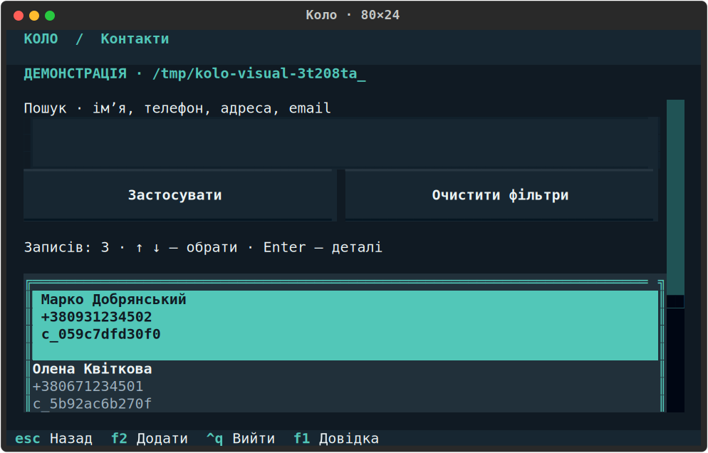

# Демонстрація Коло за 3–5 хвилин

[Документація](README.md) · [Посібник користувача](user-guide.md) · [Вимоги й результати](requirements-coverage.md)

Автор індивідуального проєкту — **Басюк Юрій**. [Код і документація на GitHub](https://github.com/iktnb/kolo-assistant).

Мета показу: за кілька хвилин пройти контакти, нотатки/теги, календар і безпечні дії на вигаданих даних. Один репозиторій містить увесь локальний термінальний застосунок; окремого сайту чи серверного розгортання для демонстрації не потрібно.

## Перед показом

Відкрийте Linux або Ubuntu WSL у справжньому терміналі. Бажаний розмір — 120×36 або 80×24; застосунок також перевірено при 60×20. Із кореня клонованого репозиторію:

```sh
uv sync --locked --all-groups
uv run --no-sync kolo --version
uv run --no-sync kolo demo
```

Версія — 1.1.0. Підготовку залежностей виконайте до показу, якщо потрібне завантаження. Далі застосунок працює офлайн. Використовуйте саме `demo` без `--data-dir`: на екрані мають бути позначка демонстрації та тимчасовий шлях. Після звичайного виходу зміни прибираються; повторний запуск відновлює початкові вигадані записи.



*Вигадані дані з реального інтерфейсу; ID, дата та тимчасовий шлях можуть відрізнятися.*

## Сценарій

| Час | Що зробити | Що пояснити |
| --- | --- | --- |
| 0:00–0:30 | Покажіть головний екран і виберіть «Контакти» стрілками та Enter | Лічильники, найближчі дні народження, українська навігація й окреме demo-сховище |
| 0:30–1:15 | Відкрийте контакт Enter, перейдіть до «Редагувати», змініть адресу та Ctrl+S; поверніться Esc | Усі поля доступні без введення ID; зміна зберігається, контекст списку лишається |
| 1:15–2:15 | У «Нотатках» натисніть F2: заголовок «План демо», два рядки тексту через Enter, тег «Навчання»; Ctrl+S | Enter у тексті додає рядок, Tab переходить між полями, збереження явне; теги — по одному на рядок |
| 2:15–2:50 | Застосуйте пошук «демо», точний тег «навчання» й порядок «Теги»; відкрийте результат і поверніться | Текст і тег діють разом; нормалізація регістру та збереження фільтрів на Back |
| 2:50–3:30 | Відкрийте «Дні народження», застосуйте 0, виберіть контакт і поверніться | 0 — сьогодні, загалом доступно 0–366 включно; правило 29 лютого поясніть словами |
| 3:30–4:30 | У деталях відкрийте видалення й скасуйте Esc. У формі змініть поле й натисніть Esc: залиште «Продовжити редагування» | Початкові підтвердження зберігають запис і чернетку; небезпечна дія потребує явного вибору |
| 4:30–5:00 | Натисніть Ctrl+Q, Tab до «Відкинути й вийти» для чернетки або «Вийти» для чистого екрана, Enter | Термінал відновлюється, тимчасові дані демонстрації прибираються |

Для трьох хвилин скоротіть редагування адреси та пояснення підтверджень, залишивши один безпечний приклад. Миша не потрібна: дії й поля доступні Tab/Shift+Tab, вибір — стрілками, Enter виконує кнопку у фокусі.

За наявності часу у формі контакту введіть `bad` в email і натисніть Ctrl+S: покажіть українську причину, фокус на email і збережені решту полів; виправте на `demo@example.com` та повторіть. Це помилка вводу на вигаданих даних; спеціально пошкоджувати сховище не потрібно.

## Якщо щось незручно під час показу

- За вузького вікна збільште термінал або переходьте Tab: сфокусована дія прокручується у видиму область.
- Для показу без кольорів використовуйте `uv run --no-sync kolo --plain demo`; це все ще повноекранний режим.
- Якщо меню каже, що потрібен термінал, запустіть команду без перенаправлення/pipe в Ubuntu Terminal.
- Не вводьте номери пунктів старого меню в повноекранному режимі. `--line-mode` є окремою сумісною оболонкою, описаною в [README](../README.md).
- Чернетка після помилки запису лишається для повторної спроби; помилка читання пропонує явні повторення/повернення/вихід і не скидає базу.

## Що дати ментору після показу

1. [Репозиторій](https://github.com/iktnb/kolo-assistant) і [вхід до документації](README.md).
2. [Матрицю всіх основних вимог і двох додаткових можливостей](requirements-coverage.md).
3. [Архітектуру](architecture.md) та [команди перевірок із фактичною атрибуцією результатів](developer-guide.md).

Постійне збереження між окремими процесами, CLI та сценарії відмов підтверджують тести й матриця; демонстраційний режим навмисно не зберігає дані між запусками. Для окремої ручної CLI-проби є ізольовані приклади в [посібнику користувача](user-guide.md).
