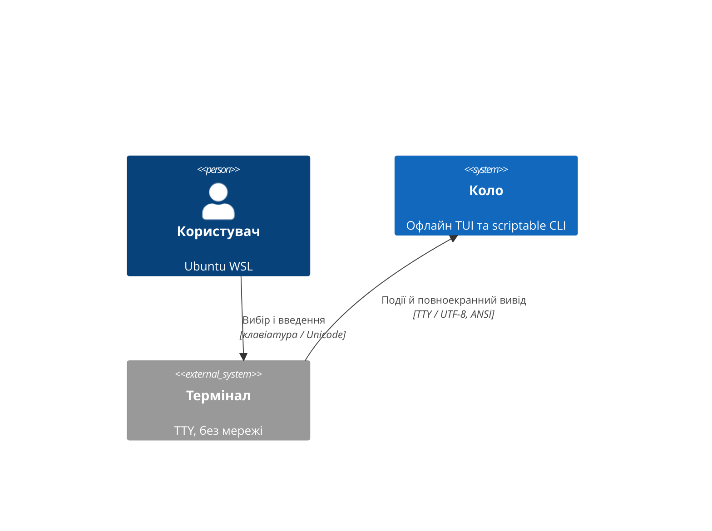
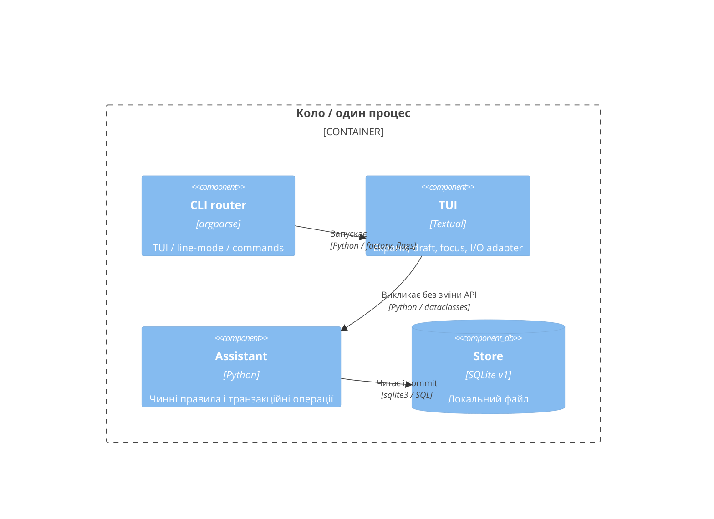

# RFC: «Коло» — повноекранне керування клавіатурою

- Статус: запропоновано для незалежного технічного огляду; 2026-10-24.
- architect-agent: `/root/tui_architect`; реалізація й реліз ще NOT RUN.
- Входи: [PRD](00-prd-delta.md), [план](00-project-plan.md), [базовий контракт](../personal-assistant/02-spec.yaml); [точна специфікація](02-spec.yaml).

## 1. Мета, обмеження та перевірені джерела

Замість запиту номера дії `kolo` відкриває український повноекранний TUI: стрілки вибирають, Enter відкриває, Esc повертає без втрати контексту. Усі TUI-AC-01—11 обов'язкові; домен, SQLite v1, ID, CLI та правила базового PRD залишаються джерелом істини. Платформа — Ubuntu WSL / Python 3.12; офлайн після встановлення.

Прочитано `cli.py`, `interactive.py`, `demo.py`, `render.py`, `services.py`, `models.py`, `errors.py`, `validation.py`, `birthdays.py`, релевантний `storage.py`, `tests/pty_driver.py`, тести CLI/menu/demo/QA, `pyproject.toml` та вихідний RFC. HEAD відсутній, `feature/personal-assistant`, remote немає. Застосовних файлових AGENTS.md/CLAUDE.md не знайдено. Контролер передав baseline: 142 PASS, 95.33% усього src; архітектор не повторював його. Jvers HLD/services/topics/principles/feature-registry/ADR registry відсутні й N/A для цього автономного проєкту; явна назва компонента для задач — `personal-assistant`.

## 2. Стратегія й компоненти

- Нові `src/kolo/tui.py` (App, стек/контекст, виконання I/O), `tui_screens.py` (огляд, списки, деталі, календар, довідка), `tui_forms.py` (форми, підтвердження, повідомлення), `tui.tcss` (спільні стилі). Дозволений компактний поділ без абстрактного UI-фреймворку.
- Native Textual Screen/ModalScreen, ListView/ListItem, Input, TextArea, Select, Button, Footer, VerticalScroll. Список має стійкий зв'язок рядок → ID; номер позиції не є ID.
- `cli.py` вибирає оболонку; `interactive.py` зберігає числовий режим; `demo.py` володіє TemporaryDirectory і використовує існуючий seed; Assistant/Store лишаються єдиним шляхом до даних.
- Спільні семантичні ролі accent/muted/success/error, темна стримана палітра, заголовок розділу, явний контур фокусу й текстові статуси. `--plain`/NO_COLOR вимикають колір, але лишають рамки, фокус і TUI. Для plain/NO_COLOR public get_line_filters() додає textual.filter.NoColor до super filters; bold/reverse лишають фокус. Чужі рядки в read-only widgets проходять `render.safe` як Text, без Rich markup.
- Редактори містять не escaped-представлення: body завантажується через lossless EOL projection нижче, решта полів — із початкових значень. Безпечність контролів перевіряється окремо; display sanitization не переписує модель.

## 3. Навігація, фокус і життєвий цикл

Home → Contacts/Notes/Birthdays/Help; список → Detail(ID) → Edit; список контактів/нотаток → Add. Стек зберігає екземпляр попереднього екрана та ListContext: тип, query/tag/sort, applied days/raw days, selected ID/index, scroll, focus widget ID. Після повернення дані перечитуються, контроли не скидаються. Збереження повертає до початкового списку й виділяє збережений ID; якщо він не відповідає фільтру, фільтр лишається й статус пояснює це. Видалення повертає до списку й вибирає min(старий index, останній index), у порожньому списку — «Додати» або інтервал.

Початково Home фокусує меню «Контакти», заповнений список — рядок, деталі — «Редагувати», форма — перше поле. Tab/Shift+Tab проходять усі видимі контроли в порядку документа; прокручування підводить фокус у viewport. Після повідомлення повертається попередній control, за FieldError — конкретне поле. Порожній список не має дії Enter над записом. Повторний запит видаляє старий прихований вибір.

Up/Down/Enter працюють у focused меню/списку; Input/TextArea/Select зберігають native клавіші. Немає глобальних букв a/e/d/q, стрілок чи Enter. TextArea: Enter — newline; Tab переходить до наступного control (не вставляє tab), Shift+Tab — назад. Зберігання — видима кнопка; текстові поля не запускають submit форми через Enter. Esc спершу закриває native popup, потім modal/екран. Footer показує українські контекстні підказки.

Dirty — значення widget відрізняється від snapshot після його ініціалізації (для body порівнюються canonical LF значення), а не від raw stored body. Back/Esc dirty → modal із default «Продовжити редагування»; явне «Відкинути» повертає. Ctrl+Q і Ctrl+C перевизначають стандартний exit Textual та проходять спільний запит виходу; dirty потребує явного відкидання, clean — підтвердження виходу. Home Esc — те саме. Delete-modal показує тип/label/ID; default «Залишити», Enter/Esc з default не видаляють. Підтверджений вихід = 0 і штатне відновлення термінала.

## 4. Runtime, помилки й узгодженість

Усі Store/Assistant I/O, включно з початковим Store, виконуються через один серіалізований адаптер на `asyncio.to_thread`; UI отримує typed result/expected error в event loop. На запуску App отримує factory Assistant + абсолютний шлях, а не вже створений Store. Це дозволяє показати початкову помилку читання всередині TUI. Кожен Store connection створюється й закривається в тій самій thread-функції. Demo seed також завершується до показу доступних дій.

Перед запуском операції UI ставить busy; одночасні submit/повторні save/delete не допускаються. Читання має generation token: результат застосовується лише до чинного екрану/запиту; за зміни фільтра зберігається останній запит для виконання після busy. Навігація/вихід під час незавершеного запису відкладаються до результату; thread не скасовується й commit не видається за скасований. Видимий «Зберігаємо…» лишає UI responsive при existing SQLite timeout 3s.

FieldError лишає всю чернетку й показує `field` + українську причину. На edit передаються тільки змінені поля (решта UNSET): це також зберігає історичні casefold-теги довжиною >40 без повторної валідації незміненого поля. Порожні optional-поля → None/(), телефони й теги — один запис на рядок; body проходить lossless projection, а не пряме зчитування TextArea.text. Успіх лише після повернення Assistant з commit. StorageError збереження лишає draft; retry — лише явна повторна дія, без автоповтору мутації. Якщо запис уже commit, а refresh впав, показати окремо «Збережено; не вдалося оновити список» й retry read.

**Lossless body adapter (локальне уточнення ADR-TUI-01).** Зберегти окремо raw_original, canonical_original, raw span для кожного canonical code point і widget_initial після load. До TextArea завантажити canonical_original: кожен Python splitlines separator (CRLF атомарно; CR/LF/VT/FF/FS/GS/RS/NEL/U+2028/U+2029) замінити одним LF, зберігши його початковий raw span; інші code points, tab, крайні й повторні переноси не змінювати. Canonicalization не використовує splitlines(False), не обрізає final separator і не виконує Unicode normalization.

На Save canonical(current widget) == canonical(widget_initial) → body UNSET, raw_original лишається byte/Unicode-exact навіть за edit заголовка; так само немає false dirty prompt. Інакше чистий helper використовує stdlib difflib.SequenceMatcher(None, canonical_original, canonical_current, autojunk=False). Для equal opcode відновити початкові raw spans, delete пропустити, insert/replace вивести current canonical substring (нові переноси, включно з Enter, — LF). Отже незмінні aligned separator boundaries, включно з trailing NEL/U+2028/U+2029, зберігаються дослівно; неоднозначний repeated text прив'язується детермінованими equal blocks SequenceMatcher (earliest original, потім earliest new tie-break), не прихованим widget history. Для new note всі переноси LF. Без private Textual hooks; знімок current передати разом із raw map у той самий worker: projection до перевірки доменом і commit; ліміт10000 рахує реконструйований raw body, помилка зберігає draft. Quadratic diff для bounded10000 не виконується в UI thread.

StorageError читання (startup, list, detail, refresh) показує абсолютний шлях і «Повторити», «Назад», «Вийти»; startup Back відкриває безпечний екран без даних із retry/exit, не робить reset. Старі результати можуть лишитися тільки з явною позначкою «Не оновлено» й вимкненими мутаціями. Відсутній ID → повідомлення + повернення до оновленого списку. Невідомі винятки не позначаються успіхом і не виводять особисті дані в traceback.

Календар та огляд беруть один snapshot `assistant.today()` на refresh й передають його до contacts/birthdays. При resume та явному Apply — нове читання; таймер раз на 60s звіряє injected today і при зміні дня оновлює видимі calendar/home, без зміни відкритої draft. Неправильний days лишає raw input і попередні результати під написом «Попередній інтервал N днів».

## 5. C4: контекст і компоненти

## 6. Контракти, дані, місткість і постачання

Новий глобальний `--line-mode` перед командою вибирає попередню оболонку для menu/demo; для scriptable команд це не впливає на семантику. Додати його до excluded global options у `cli._prepare`, щоб no-op edit лишився помилкою. Без TTY menu/demo = 2 до доступу до даних, зокрема з --plain/--line-mode. Решта stdout/stderr/exit-кодів CLI незмінні. HTTP/Kafka/сервер/контейнери N/A; схема, індекси й обсяг даних не змінюються, тому новий capacity/migration розділ N/A.

Версія застосунку 1.1.0 у pyproject та __init__; додати runtime Textual із точною сумісною pin у pyproject/uv.lock. [PyPI](https://pypi.org/project/textual/) на перевірку показав 8.2.8 і Python >=3.9,<4; це кандидат, не доказ сумісності з поточним Rich. Developer мусить підтвердити resolver, imports, strict types, аудит усіх lock-груп і wheel. TCSS має бути у wheel; запуск installed wheel з іншого cwd перевіряє CSS_PATH. Demo banner/path постійно видимі; TemporaryDirectory живе до exit й завершення всіх I/O; personal data_directory взагалі не викликається.

Порядок: dependency/router → вертикальний список/detail/form → filters/calendar/errors → regressions/QA → README й локальне перевстановлення. Rollback: `--line-mode` або попередня локальна версія; дані v1 без downgrade. Жодного commit/push/publication. [Чекліст](03-test-checklist.md) і [задачі](04-tasks.md) визначають доказ кожного AC; нові результати поки NOT RUN.

## 7. Рішення, альтернативи та ризики

**Локальний ADR-TUI-01 — Textual, прийняте продуктове рішення.** Rich сам не дає lifecycle/focus/keyboard-test; ручний curses/prompt-toolkit потребував би власних форм, layout і тестового драйвера. Textual повторно використовує Rich, native widgets, scrolling, Pilot; ціна — runtime-залежність, async межа й перевірка packaging. Окремий ADR файл не створено: завдання дозволяє лише ці п'ять файлів, як і попередній незалежний RFC. [Workers](https://textual.textualize.io/guide/workers/), [input](https://textual.textualize.io/guide/input/), [testing](https://textual.textualize.io/guide/testing/) перевірені для обмежень thread/UI, priority exit і Pilot; точні API звірити з обраною pin.

- Sync SQLite у UI простіший, але відомий 3s lock timeout заморожує фокус; мінімальний єдиний worker лишає чинний Store.
- Ризики: випадковий стандартний Ctrl+Q/Ctrl+C, TextArea Tab/Enter, control chars у редакторі, clip при 60×20, втрачений async result. Усі мають конкретні негативні тести.
- Контейнеризація, tracing, брокери, кеші й мережевий auth N/A: один локальний процес/користувач.
- Матеріальних відкритих питань немає. Неперевірені версія залежності, layout та інсталяція — технічні перевірки наступних етапів.
