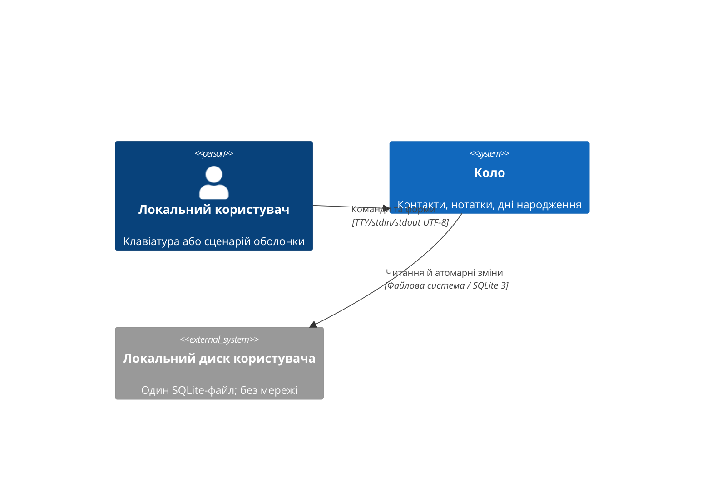
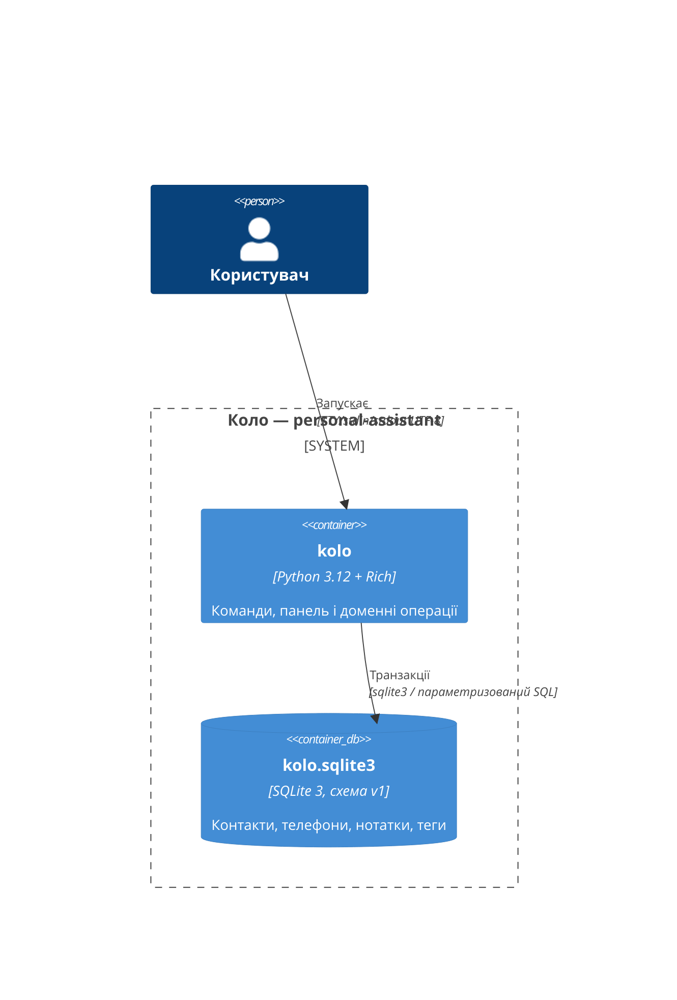

# RFC: «Коло» — локальний персональний помічник

- Статус: запропоновано для незалежного технічного огляду; 2026-10-24.
- Автор чернетки: architect-agent `/root/architect` (перерваний етап); завершення: architect-agent `/root/architect_resume`.
- Специфікація: [02-spec.yaml](02-spec.yaml). Вхід: [PRD](00-prd-delta.md), [план](00-project-plan.md).
- Реліз: не перевірено; це лише архітектура, коду ще немає.

## 1. Підсумок, проблема та цілі

«Коло» зберігає контакти й нотатки локально та показує найближчі дні народження. Один Python-процес надає українську інтерактивну панель і команди `kolo`; обидва шляхи використовують однакові правила й SQLite-транзакції.

Перевірена база: `/home/iknow/goit-projects/personal-assistant`, гілка `feature/personal-assistant`, без HEAD, remote, коду, залежностей або тестового baseline; є лише SDD-документи. Python 3.12.3, uv 0.8.10 за вхідним планом. Хеш PRD: `9684368f89e3ed8800c74753269dc98feea449bcdd858e849bc3ce1ac8eaafed`; плану: `bdcc8409dc4e342cc198ac17240db316c7363b9da956f278d603209426704d63`. Застосовних файлових AGENTS.md/CLAUDE.md не знайдено. Мета — усі AC-01—AC-16 без мережі під час користування.

Межі: один локальний користувач, WSL Ubuntu, Python 3.12; без вебінтерфейсу, сервера, хмари, імпорту/експорту, фонового нагадування, шифрування або одночасного спільного редагування. Jvers HLD/services.yaml/Kafka/ADR-реєстр, HTTP, Kubernetes, брокери, circuit breaker і distributed tracing — N/A: це новий незалежний CLI. До Jvers не звертаємося.

## 2. Стратегія та компоненти

Єдиний компонент із сервісним ідентифікатором `personal-assistant`. Пакет `src/kolo`, Python dataclasses і звичайні функції; runtime-залежність лише Rich. `argparse`, `sqlite3`, `datetime`, `uuid`, `tempfile`, `pathlib` і ввід рядків — стандартна бібліотека. Немає prompt-toolkit: цифрове меню й підказки не потребують додаткового термінального рушія; автодоповнення відкладається, довідка й видимі дії покривають навігацію.

| Файл | Відповідальність |
|---|---|
| `__init__.py`, `__main__.py`, `cli.py` | Версія, `python -m kolo`, argparse/маршрути, коди завершення; без бізнес-правил |
| `models.py`, `validation.py`, `errors.py` | Незмінні Contact/Note, перевірка/нормалізація, типізовані помилки |
| `services.py`, `birthdays.py` | CRUD, Unicode-пошук/сортування, календар із переданою поточною датою |
| `storage.py` | Шляхи, версія/цілісність, схеми й транзакції SQLite, мапування записів |
| `render.py` | Rich-тема, буквальний безпечний текст, списки/деталі/повідомлення |
| `interactive.py` | Цикли панелі/меню, чернетки форм, повтор поля, Ctrl+C/EOF |
| `demo.py` | Вигадані дані в TemporaryDirectory, нуль доступів до особистого сховища |

Залежності: CLI/interactive → services → storage; services → validation/models/birthdays; CLI/interactive → render. Storage не друкує й не питає; render не змінює дані. Поточна дата, генератор ID, потоки й шлях сховища передаються явно для тестів. Немає глобального кешу чи бази, відкритої при імпорті.

## 3. Контекст і будова (C4)





Container тут означає C4-блок програми/сховища, без Docker. Component-діаграма N/A: наявного сервісу, який реструктурується, немає; межі модулів визначені таблицею.

## 4. Зовнішній контракт і сценарії

Точні прапорці, схеми та правила — самодостатній `02-spec.yaml`. Глобальні опції стоять перед підкомандою. Основні приклади:

```text
kolo
kolo --data-dir /tmp/kolo-example contacts add --name "Олена" --phone "+38 (067) 123-45-67"
kolo contacts list --search "олена"
kolo contacts edit c_0123456789ab --clear-email
kolo notes add --title "Ідеї" --body "Перша думка" --tag Робота
kolo notes list --search "думка" --tag робота --sort tags
kolo birthdays --days 7
kolo demo
```

ID — повний `c_`/`n_` + 12 нижніх hex-символів, незмінний і унікальний у відповідній таблиці; команди приймають лише повний ID. Однакові імена/заголовки й реквізити різних контактів дозволено. PK і повтор генерації при колізії забезпечують унікальність; немає небезпечного вибору за іменем або префіксом.

Меню: «1 Контакти · 2 Нотатки · 3 Дні народження · 4 Довідка · 0 Вийти». Формам передує інструкція скасування. Поля перевіряються окремо до збереження; чернетка живе тільки в пам’яті. На редагуванні Enter залишає поле, `!clear` очищує необов’язкове, `!!clear` вводить буквальне `!clear`. Текст нотатки вводиться рядками до окремого `.`; початкове `..` знімає одну крапку. На редагуванні спершу запит «Змінити текст? [т/Н]», тому порожні рядки тексту не втрачаються. Деталі є повними; списки завжди показують повний ID і спосіб відкрити запис.

Поточна дата визначається через `zoneinfo.ZoneInfo("Europe/Kyiv")`, незалежно від UTC-налаштування WSL; непорожній `KOLO_TIMEZONE` може задати іншу IANA-зону. Невідома зона — українська помилка вводу з кодом 2 до відкриття сховища; help/version її не потребують. Clock повертає aware datetime; дата знімається один раз на доменну операцію/оновлення панелі, а в тестах clock ін’єктується. Часовий пояс ОС не змінюється. Перевірено на хості: `Europe/Kyiv` доступна, `2026-10-23T22:30Z` дає дату `2026-10-24`.

Дні народження: інтервал `[today, today + N]`, N=0…366, один найближчий випадок на контакт; 29 лютого → 28 лютого лише в невисокосному році. Пошук/сортування виконується Python `casefold`, а не SQLite `NOCASE`, який не дає потрібної Unicode-поведінки. Теги — `strip().casefold()`, deduplicate, лексикографічне сортування; нотатки без тегів останні при сортуванні за тегами.

## 5. Дані, транзакції та сумісність

Авторитетне сховище одне: `kolo.sqlite3` у `--data-dir`, інакше `$XDG_DATA_HOME/kolo` для непорожнього абсолютного XDG-шляху, інакше `~/.local/share/kolo`. Відносний XDG ігнорується за XDG-конвенцією; явний відносний data-dir прив’язується до cwd на старті. Показуємо абсолютний шлях. `.env` не читається.

Чотири таблиці: `contacts`, `contact_phones`, `notes`, `note_tags`; точний DDL у spec. Телефони й теги належать батьківському запису та видаляються каскадно. Схема v1 позначена `PRAGMA user_version=1`, `application_id=0x4B4F4C4F`. Невідомі версії не мігруються й не перезаписуються.

Перед writable-відкриттям наявного файлу — readonly-перевірка application_id/user_version, очікуваної структури, `quick_check`, `foreign_key_check` і валідності завантажених сутностей. Вузький виняток: якщо readonly-перевірка повертає саме `SQLITE_READONLY_ROLLBACK` (776), а 100-байтовий заголовок має сигнатуру SQLite 3, `user_version=1` (big-endian offset 60) і `application_id=0x4B4F4C4F` (offset 68), дозволити `mode=rw` без створення файлу лише для штатного rollback recovery SQLite; потім повторити повну readonly-перевірку. Не розбирати/переписувати journal власним кодом і не змінювати схему до завершення перевірок. Невідома сигнатура/версія, zero-byte, інша readonly-помилка або невдале native recovery — code 1, без reset/заміни/видалення оригіналу. За recovery SQLite може відкотити незавершені сторінки й видалити journal; це дозволене відновлення останнього commit. Для звичайних corrupt/unknown fixtures поза цим винятком хеш має бути незмінним.

Лише відсутній `kolo.sqlite3` дозволяє ініціалізацію. Створити приватний випадково названий `.kolo-init-*` tempfile у тому самому data-dir із 0600; лише в ньому виконати DDL/application_id/user_version однією транзакцією, COMMIT з DELETE/FULL, закрити SQLite й fsync файл. Повністю committed базу опублікувати атомарним `os.link(temp, final)` без перезапису; fsync data-dir, unlink лише власного temp, повторний fsync data-dir до успіху. Якщо final уже існує або hard-link/fsync недоступні — code 1 без заміни final; ніякого `os.replace` fallback. Оброблена помилка прибирає лише власний private temp/journal. Crash до commit/публікації залишає final відсутнім; crash після публікації залишає повну v1. Залишки приватних temp після kill ігноруються наступним startup, який створює інший temp; автоматичного сканування/видалення чужих файлів немає. Нові власні каталоги мають 0700; прав наявних батьків не змінюємо.

`foreign_keys=ON`, `journal_mode=DELETE`, `synchronous=FULL`, `busy_timeout=3000`. Кожна мутація: BEGIN IMMEDIATE → прочитати поточний запис → зібрати й перевірити всю нову сутність → параметризовані зміни батька/дітей → COMMIT → лише тоді «Збережено». Помилка до commit викликає rollback, скидання чернетки прийнятого результату і повторне читання з диска. Стан у пам’яті не видається за збережений. SQLite rollback journal захищає від обриву процесу; гарантія не охоплює поломку носія/некоректний fsync файлової системи. Додаткова копія даних не створюється, прикладне відновлення пошкоджених файлів відсутнє; є лише описаний native SQLite rollback для розпізнаного сховища.

## 6. Оцінка місткості й ризик міграції

Спостережений стан — 0 прикладних записів/0 байт бази. Нижче оцінка, не вимірювання: один користувач, +10 контактів і +10 нотаток на тиждень; середня нотатка 2 KiB, контакт із телефонами 1 KiB, запас ×2 на сторінки/індекси. Очікування: 1 місяць ~80 батьківських записів / <1 MiB; 6 місяців ~520 / <4 MiB; 12 місяців ~1040 / <8 MiB. Максимальні тексти й багато тегів можуть перевищити оцінку; QA використовує також 10 000 записів для перевірки придатності повного сканування.

Індекси: PK ID, складені PK/UNIQUE дочірніх таблиць, UNIQUE(contact_id, digits). Для коротких телефонів/тегів складені індекси можуть перевищити 20% розміру таблиці — свідомий невеликий абсолютний обсяг задля цілісності. Додаткових пошукових індексів немає; пошук читає сутності й обробляє їх у Python. Навантаження переважно читання, планове відношення 10:1; реплік немає. Поріг 50 млн рядків за рік не наближається, розбиття/архівація N/A. Наявних ALTER TABLE немає: початковий DDL лише для нового файлу; lock >1 s не прогнозуємо, майбутня міграція потребуватиме окремого контракту й резервної копії.

## 7. Рішення та альтернативи

Вбудовані ADR нижче є реєстром цього незалежного проєкту; окремі ADR-файли не створюються через дозволені лише п’ять шляхів цього етапу.

1. **ADR-01 SQLite stdlib, v1.** JSON із tempfile+replace простіший для огляду, але потребує власної атомарності, версіонування та повного перезапису. SQLite дає перевірені транзакції, FK і crash recovery без runtime-пакета. Ціна — бінарний файл, явна перевірка схеми й блокування.
2. **ADR-02 argparse + Rich.** Typer/Click додають залежності для невеликого дерева команд; prompt-toolkit виправданий для повноекранного/доповнюваного UI, якого тут не потрібно. Числові меню, стандартний ввід і спільний Rich-renderer достатні; усі повідомлення/помилки parser українські.
3. **ADR-03 Python Unicode-пошук.** Повний скан обрано замість FTS/кастомних SQLite collation для малої локальної бази; поведінка `casefold` однакова для CLI/UI. Повернутися до індексів, якщо виміряний список 10 000 записів стає непридатним.

## 8. Якість, безпека та вимірювання

`pyproject.toml`: Python >=3.12,<3.13; console script `kolo=kolo.cli:main`, src-layout, hatchling build backend, зафіксований `uv.lock`. Dev-only: Ruff, mypy, pytest, pytest-cov, Bandit, pip-audit. Усі Python-файли, включно з тестами, проходять Ruff/mypy; покриття всього `src/kolo`, включно з CLI/render/interactive/demo, >=80%. PTY-тести стандартного модуля `pty` у WSL перевіряють реальні Ctrl+C/EOF, збереження чернетки при повторі поля та ширини 60/80/120. Не виключати UI з coverage.

Повна матриця assertions і команди — `03-test-checklist.md`. Обов’язкові повний pytest, Ruff format/lint, mypy всього репозиторію, Bandit source і аудит усіх resolved runtime/dev залежностей. Новий baseline: NOT RUN, бо app/tests ще немає; відсутність тестів не є PASS.

Локальні дані не надсилаються в мережу й не потрапляють у технічні tracebacks/logs. Усі SQL-значення параметризовані. Rich отримує `Text`, не markup із даних; C0/C1/Cf відображаються без виконання, newline у багаторядкових полях зберігається, tab розгортається. `NO_COLOR`/перенаправлення вимикають ANSI. Без TTY команди не чекають вводу; відсутня команда або `demo` дають код 2 із підказкою.

## 9. Порядок, запуск і відкат

Порядок: packaging → моделі → SQLite → доменні операції → команди → UI/demo → повний gate/незалежні огляди → README/запуск. Деталі в `04-tasks.md`. Перший запуск створює v1; існуючі дані невідомої версії залишає недоторканими. Розгортання/серверу немає. Відкат коду не стирає каталог даних; попередньої версії формату ще немає, автоматичного downgrade немає.

`./run.sh` запускає встановлене uv-середовище без sync/мережі та працює з іншого cwd. Після `uv sync --locked` перевірити `uv run --no-sync kolo --help`, PTY-demo та build. За рішенням контролера після QA — `uv tool install --python 3.12 .`, тоді `/home/iknow/.local/bin/kolo --help`; це локальна інсталяція, не публікація. Опційний `start-kolo.cmd` відкриває WSL-запуск з Windows. README українською описує ці шляхи й розташування даних.

Demo створює вигадані записи лише в новій TemporaryDirectory; у одного контакту birthday = `today.replace(year=min(2000, today.year))` із того самого snapshot clock. Високосний 2000 рік дозволяє кожен місяць/день; для дат раніше 2000 залишається today. Дата завжди валідна <=today; за `2028-02-29` це `2000-02-29` і `days_until=0`. Особистий data-dir не визначається й не читається.

## 10. Ризики та відкриті питання

- SQLite IO/permission/locked/corrupt → українська помилка з абсолютним шляхом, без reset і без повідомлення успіху. Невідомий стан диска потребує ручного розбору, не самолікування.
- Звичайний термінал не дає повноекранної навігації; усі дії мають короткі видимі числові команди й текстову довідку.
- Розмітка, ESC, bidi/control у даних → лише безпечне буквальне відображення; оригінал даних не руйнується.
- Припущення місткості треба підтвердити на синтетичних даних; вимоги жорсткої затримки не вигадуємо.
- Матеріальних продуктових питань немає. Технічне схвалення, незалежні огляди й реалізація ще попереду; цей RFC не дозволяє commit/push/публікацію.
